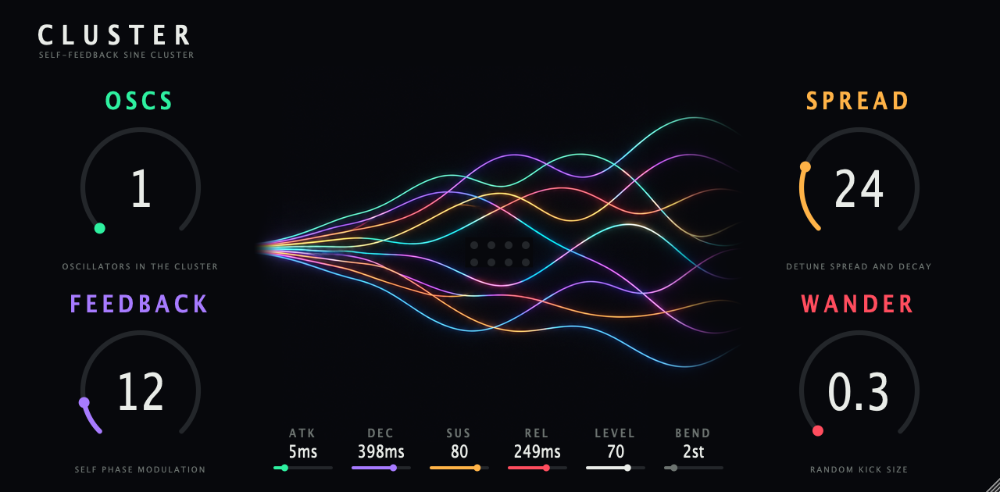

# Cluster



A new take on the OP-1 cluster synth engine, as an instrument plugin. Eight self-feedback sine oscillators that drift apart
over a note. One shared DSP core, every format from one repo.

| Format | Platform | Built from |
|---|---|---|
| VST3, CLAP, Standalone | macOS (universal, 11.0+) | JUCE, `CMakeLists.txt` |
| AU | macOS | JUCE |
| AAX | macOS, Windows | JUCE, needs the AAX SDK and signing, not built here |
| VST2 | Akai MPC OS standalone devices (Gen1 armv7, Gen2 aarch64) | `mpc/`, built with [mpc-vst-plugins](https://github.com/sd88me/mpc-vst-plugins) |

## Controls

Names and defaults come from the OP-1 screen (factory values 4000, 4000, 8000, 100 of 32767).

| Control | What it does |
|---|---|
| OSCS | Oscillators in the cluster, 1 to 8. |
| FEEDBACK | How hard each oscillator modulates its own phase, and how that drifts over the note. |
| SPREAD | How long each oscillator's detune lasts. |
| WANDER | How hard the detune is kicked at random. |
| ATK, DEC, SUS, REL | Amp envelope, 1 ms to 5 s. |
| LEVEL | Output level. |
| BEND | Pitch bend range, 0 to 12 semitones. |

8 voices, velocity, pitch bend, CC1 mod wheel (adds feedback), CC64 sustain, all-notes-off.

## DSP

`core/cluster_core.c` is plain C99 with no allocation. It is written from scratch as float DSP. It is not a bit-exact port of
the OP-1 fixed-point code, and it carries no firmware code or tables. See `docs/DSP.md` for what came from the decompile
and what I chose myself.

## Build

```sh
cd ~/bombest-audio/op1-fx
cmake -S . -B build/cluster -G Ninja -DCMAKE_BUILD_TYPE=Release -DOP1FX_ONLY=cluster \
  -DFETCHCONTENT_SOURCE_DIR_JUCE=$HOME/JUCE \
  -DFETCHCONTENT_SOURCE_DIR_CLAP-JUCE-EXTENSIONS=$HOME/bombest-audio/op1-fx/.deps/clap-juce-extensions
cmake --build build/cluster --parallel 4
cmake --build build/cluster --target ClusterSnapshot   # editor to PNG
```

Core tests (sanitizers on):

```sh
core/tests/run.sh
```

MPC VST2 (needs Docker):

```sh
../../../mpc-re/mpc-vst-plugins/tools/test_port.sh mpc/vst.json
../../../mpc-re/mpc-vst-plugins/tools/build_port.sh mpc/vst.json all
```

## Design

Layout notes are in `design/BRIEF.md`. The centre art is generated with Higgsfield and lives in `design/art/`.
`faceplate-bg-1280x630.png` is the shared background for the plugin window and the MPC skin. The Claude Design project is
https://claude.ai/design/p/23533524-9bf0-406a-9ce4-d5fb16f22eab
