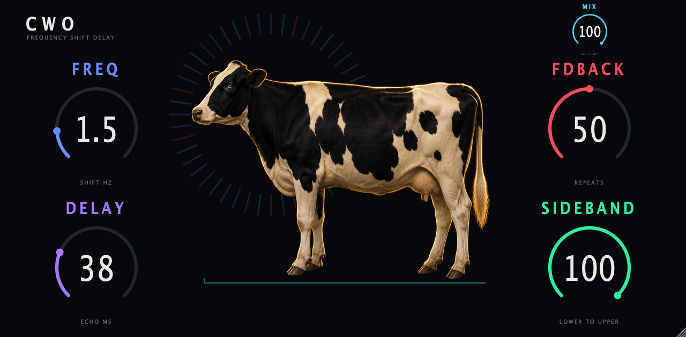

# Cwo



A new take on the OP-1 CWO effect, as a plugin: a stereo delay with a single-sideband frequency shifter in its feedback loop. Four
controls plus MIX, one shared DSP core, every format from one repo.

| Format | Platform | Built from |
|---|---|---|
| VST3, CLAP, Standalone | macOS (universal, 11.0+), Windows | JUCE, `CMakeLists.txt` |
| AU | macOS | JUCE |
| VST2 | Akai MPC OS standalone devices (Gen1 armv7, Gen2 aarch64) | `mpc/`, built with [mpc-vst-plugins](https://github.com/sd88me/mpc-vst-plugins) |

## Controls

Names and defaults of the first four come from the OP-1 (factory values 5000, 8192, 16384, 32767 of 32767). MIX is an addition.

| Control | What it does |
|---|---|
| FREQ | How far the echoes are shifted in frequency. 0 to 4 kHz, exponential. |
| DELAY | Echo time, 1 to 600 ms. Changing it bends the pitch of the echoes. |
| FDBACK | How much of each shifted echo goes back into the delay. Up to gain 0.92. |
| SIDEBAND | Lower sideband at 0, ring modulation at 50, upper sideband at 100. |
| MIX | Dry to wet, for running the effect in parallel. 0 is your input bit for bit, 100 (default) is the full effect. The echoes scale with it, the dry stays. |

Each echo is shifted again by the one before it, so a small FREQ at high FDBACK gives a rising or falling spiral. The cow's halo turns with
the shift: clockwise for the upper sideband, counter-clockwise for the lower, still at ring modulation. Its brightness follows the level of
the shifted echoes.

## DSP

`core/cwo_core.c` is plain C99 with no allocation. It is written from scratch as float DSP. It is not a bit-exact port of the OP-1
fixed-point code, and it carries no firmware code or tables. See `docs/DSP.md`.

## Build

macOS, all formats:

```sh
cmake -S . -B build/cwo -G Ninja -DCMAKE_BUILD_TYPE=Release -DOP1FX_ONLY=cwo
cmake --build build/cwo
```

Add `-DFETCHCONTENT_SOURCE_DIR_JUCE=$HOME/JUCE` to reuse a local JUCE checkout.

Core tests (sanitizers on):

```sh
core/tests/run.sh
```

MPC VST2, with a checkout of mpc-vst-plugins next to this repo (needs Docker):

```sh
../mpc-re/mpc-vst-plugins/tools/test_port.sh plugins/cwo/mpc/vst.json
../mpc-re/mpc-vst-plugins/tools/build_port.sh plugins/cwo/mpc/vst.json all
```

## Status

Validated on macOS: the core tests, VST3 (pluginval, strictness 8), CLAP (clap-validator) and the MPC port (offline host test on x86 and
arm64, `.so` built for armv7 and aarch64). The Standalone and the AU build, but there is no validator run for the Standalone. Not validated: AU (the component is not installed, so `auval` cannot find
it), AAX (no SDK here), Windows, and the device. The sound has not been compared with a real OP-1.

## Design

Faceplate layout is in the Claude Design project "Cwo faceplate". The cow is generated with Higgsfield and lives in `design/art/`.
`faceplate-bg-1280x630.png` is built from it by `design/make_faceplate.py` and is shared by the plugin window and the MPC skin. Its alpha
channel is a mask of the cow, so the editor can draw the live halo behind it. The MPC skin came out as the cow and the floor line on the plate,
with no halo. See `design/BRIEF.md`.

## Presets

12 factory presets, picked using Devvon Terrell's mixing guidance. Preset 0 (Init) is the OP-1 default. Source of truth: `mpc/presets.json` (feeds the MPC PRESET menu and the DAW program list). Details and sources: `docs/PRESETS.md`.
