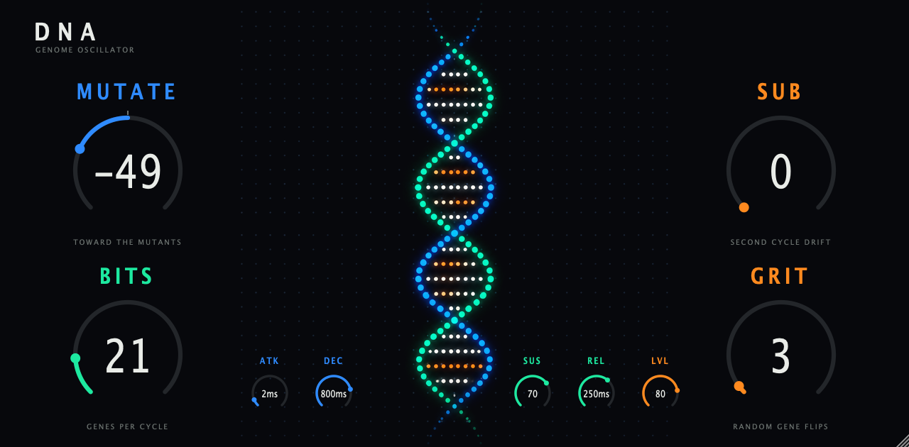

# DNA



A new take on the OP-1 dna synth engine, as a plugin. A 128-bit genome is played as a one-bit wave through an exact
anti-aliased reader, eight voices, four screen knobs (MUTATE, BITS, SUB, GRIT) plus ATTACK, DECAY, SUSTAIN, RELEASE and
LEVEL. It is inspired by the OP-1 engine, not bit-exact. See `docs/DSP.md` for which facts came from the firmware and what
is my own design.

Formats: VST3, AU, CLAP and Standalone on macOS (universal, minimum macOS 11.0), plus a VST2 for the Akai MPC
(`mpc/`, uid `BbDn`). Bundle id and CLAP id are `audio.bombest.dna`, manufacturer code `Bomb`, plugin code `OpDn`.

## Build

macOS, all formats (from the op1-fx root):

```sh
cmake -S . -B build/dna -G Ninja -DCMAKE_BUILD_TYPE=Release -DOP1FX_ONLY=dna
cmake --build build/dna
cmake --build build/dna --target DNASnapshot   # renders the editor to a PNG, no host needed
```

Core tests (sanitizers on; the host timing line always prints):

```sh
core/tests/run.sh
```

MPC VST2, with a checkout of mpc-vst-plugins (needs Docker):

```sh
mpc-vst-plugins/tools/test_port.sh mpc/vst.json
mpc-vst-plugins/tools/build_port.sh mpc/vst.json all
```

## Controls

| Knob | Range | Does |
|------|-------|------|
| MUTATE | -100 to 100 | drifts the genome toward a different mutant each way |
| BITS | 2 to 128 | genes per cycle |
| SUB | 0 to 100 | second cycle departs from the first |
| GRIT | 0 to 100 | per-voice random gene flips |
| ATK, DEC, REL | 1 ms to 5 s | envelope times, exponential |
| SUS, LVL | 0 to 100 | sustain level, output level |

MIDI: notes with velocity, pitch bend (range 1 to 12 semitones), mod wheel as vibrato, CC 64 sustain pedal, CC 120 and 123
all notes off.

## Design

Faceplate layout is in the Claude Design project "DNA faceplate": https://claude.ai/design/p/c0c8b6a9-7bb0-430b-a035-8efdb8dc7145
Art is generated with Higgsfield and lives in `design/art/`. `faceplate-bg-1280x630.png` is the shared background for the
plugin window and the MPC skin. The layout is also described in `design/BRIEF.md`.
