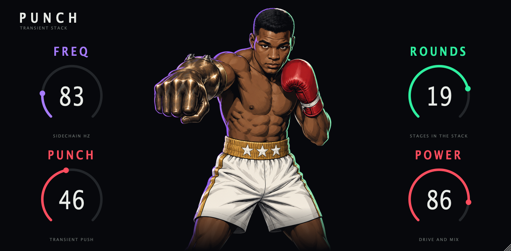

# Punch



A new take on the OP-1 Punch effect, as a plugin. Four controls, one shared DSP core, every format from one repo.

| Format | Platform | Built from |
|---|---|---|
| VST3, CLAP, Standalone | macOS (universal, 11.0+), Windows | JUCE, `CMakeLists.txt` |
| AU | macOS | JUCE |
| VST2 | Akai MPC OS standalone devices (Gen1 armv7, Gen2 aarch64) | `mpc/`, built with [mpc-vst-plugins](https://github.com/sd88me/mpc-vst-plugins) |

## Controls

Names and defaults come from the OP-1 (factory values 6000, 15000, 20000, 28000 of 32767).

| Control | What it does |
|---|---|
| FREQ | Corner of the sidechain high-pass. Only content above it triggers a punch. 30 Hz to 7.7 kHz. |
| PUNCH | How hard a detected transient is pushed. About +13 dB at full, split across the active rounds. |
| ROUNDS | Number of stages in the stack, 1 to 24. Each round listens on a longer time scale than the last. |
| POWER | Input drive and dry/wet mix together. At 0 the audio passes through bit for bit. |

## DSP

`core/punch_core.c` is plain C99 with no allocation. It is written from scratch as float DSP. It is not a bit-exact
port of the OP-1 fixed-point code, and it carries no firmware code or tables. See `docs/DSP.md`.

## Build

macOS, all formats:

```sh
cmake -S . -B build/mac -G Ninja -DCMAKE_BUILD_TYPE=Release
cmake --build build/mac
```

Set `-DFETCHCONTENT_SOURCE_DIR_JUCE=$HOME/JUCE` to reuse a local JUCE 8.0.8 checkout.

Core tests (sanitizers on):

```sh
core/tests/run.sh
```

MPC VST2, with a checkout of mpc-vst-plugins next to this repo (needs Docker):

```sh
../mpc-re/mpc-vst-plugins/tools/test_port.sh mpc/vst.json
../mpc-re/mpc-vst-plugins/tools/build_port.sh mpc/vst.json all
```

Windows builds run in GitHub Actions (`.github/workflows/build.yml`).

## Design

Faceplate layout is in the Claude Design project "Punch faceplate". Boxer art is generated with Higgsfield and lives in
`design/art/`. `faceplate-bg-1280x630.png` is the shared background for the plugin window and the MPC skin.
Claude Design's standalone MCP server stops working on 2026-12-14, so the layout is also described in `design/BRIEF.md`.

## Presets

12 factory presets, picked using Devvon Terrell's mixing guidance. Preset 0 (Init) is the OP-1 default. Source of truth: `mpc/presets.json` (feeds the MPC PRESET menu and the DAW program list). Details and sources: `docs/PRESETS.md`.
