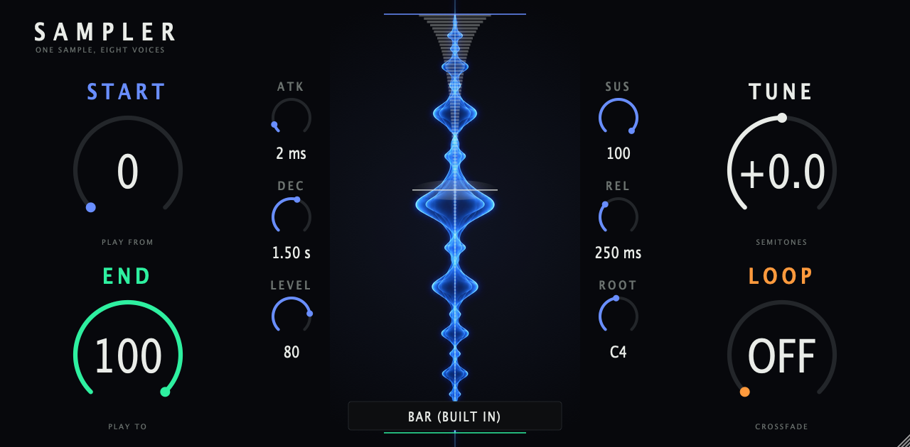

# Sampler

A new take on the OP-1 sampler synth engine (firmware codename SynthSampler). Plays one sample across the keyboard with eight
voices. Four screen knobs: START, END, TUNE, LOOP. Plus attack, decay, sustain, release, level and a root note.
Plugin id `sampler`, code `OpSm`, MPC uid `BbSm`.

Load a WAV or AIFF by clicking the name bar at the bottom of the window or by dropping a file on the window. The path is saved
with the session. Without a file it plays a built-in generated sample (three are available from the same menu).

- `core/` portable C99 DSP and tests (`core/tests/run.sh`)
- `plugin/` JUCE processor, editor and the Snapshot dev tool
- `mpc/` MPC OS VST2 port. It scans a `samples/` folder next to the `.so` for `.wav` files and offers them, after the three
  built-in ones, as a whole-number `sample` parameter. Two generated files ship in `mpc/samples/` and must be installed next to
  the `.so` in the plugin folder. `gen_samples.c` makes them.
- `design/` faceplate art and brief
- `docs/DSP.md` what the DSP does and what it is derived from

Not bit-exact with the OP-1. The firmware decompile for this engine is thin, so most of the design is mine, see `docs/DSP.md`.
