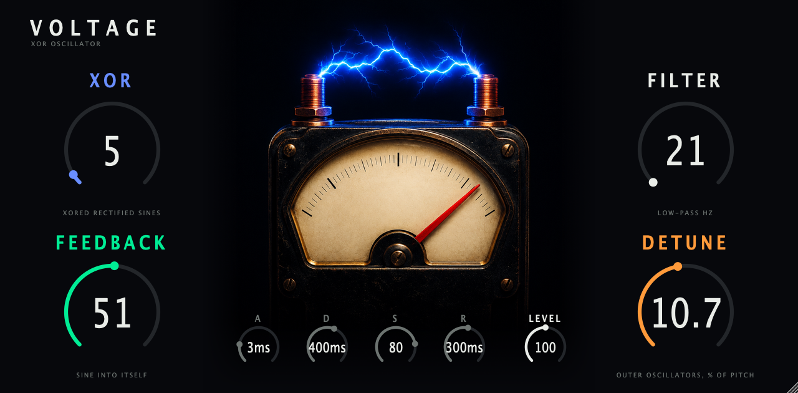

# Voltage



A new take on the OP-1 Voltage synth engine (Slump in the firmware, `volts` on its screen), as an instrument plugin. Four
controls from the OP-1 screen, an amp envelope and a level knob, eight voices, one shared DSP core, every format from one repo.

| Format | Platform | Built from |
|---|---|---|
| VST3, CLAP, Standalone | macOS (universal, 11.0+) | JUCE, `CMakeLists.txt` |
| AU | macOS | JUCE |
| VST2 | Akai MPC OS standalone devices (Gen1 armv7, Gen2 aarch64) | `mpc/`, built with [mpc-vst-plugins](https://github.com/sd88me/mpc-vst-plugins) |

## Controls

Names and defaults come from the OP-1 (factory values 1516, 16704, 0, 15168 of 32767).

| Control | What it does |
|---|---|
| XOR | How much of the XOR of two rectified sines is mixed in. Harsh and chaotic at the top. |
| FEEDBACK | How hard each sine modulates its own phase. |
| FILTER | Low-pass cutoff on the oscillator mix, up to about 17 kHz over the first half of the knob. The whole range also sets the slope of the sync ramp. |
| DETUNE | Spread of the two outer oscillators around the played pitch, up to 50 percent on a squared curve. |
| A, D, S, R | Amp envelope. |
| LEVEL | Output gain. |

MIDI: notes with velocity, pitch bend (2 semitones), mod wheel (vibrato), sustain pedal, all notes off.

## DSP

`core/voltage_core.c` is plain C99 with no allocation. It is written from scratch as float DSP. It is not a bit-exact port of
the OP-1 fixed-point code, and it carries no firmware code or tables. See `docs/DSP.md`.

## Build

macOS, all formats (run from the `op1-fx` root):

```sh
cmake -S . -B build/voltage -G Ninja -DCMAKE_BUILD_TYPE=Release -DOP1FX_ONLY=voltage
cmake --build build/voltage
```

Core tests (sanitizers on):

```sh
core/tests/run.sh
```

MPC VST2 (needs Docker):

```sh
../../../mpc-re/mpc-vst-plugins/tools/test_port.sh mpc/vst.json
../../../mpc-re/mpc-vst-plugins/tools/build_port.sh mpc/vst.json all
```

## Design

Faceplate layout is in the Claude Design project https://claude.ai/design/p/934df742-2a34-4293-9486-17c38e524f02 and in
`design/BRIEF.md`. The meter art is generated with Higgsfield and lives in `design/art/`. `faceplate-bg-1280x630.png` is the
shared background for the plugin window and the MPC skin.
